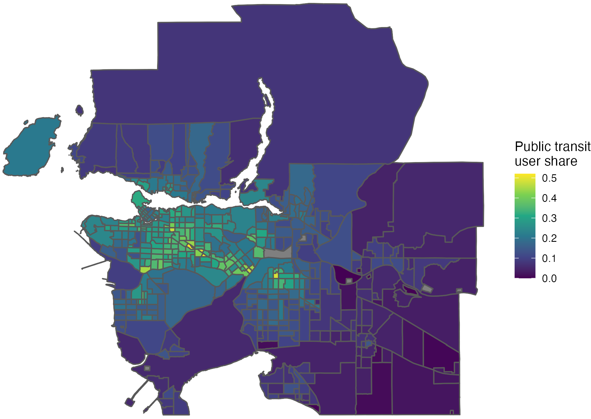
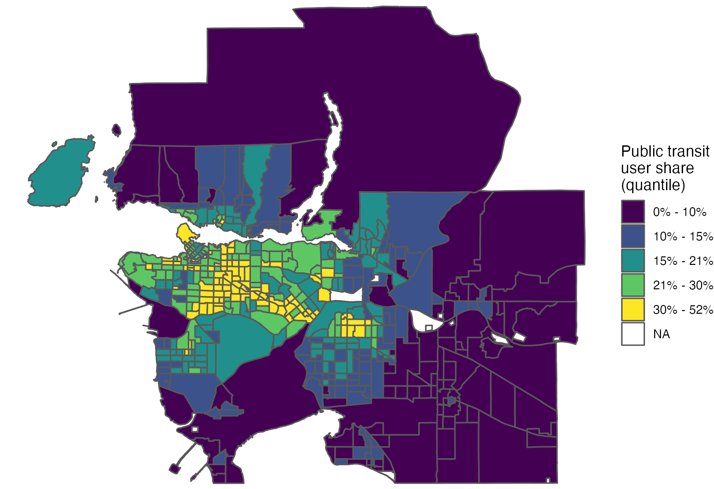

```{r}
#| label: translated-setup
#| include: false
knitr::opts_chunk$set(comment = NA)
suppressPackageStartupMessages(library(tidyverse))
suppressPackageStartupMessages(library(kableExtra))
```


## Continuous values can be hard to compare


::: {.center}
```{r echo=FALSE, out.width='80%', eval=FALSE}
knitr::include_graphics("22_pub_tr_sh.png")
```

{.plot-image}
:::


::: {.notes}
[Sources]

- Course source: `../docs_2026/21_discretizing_map_colors.Rmd`.
:::

---


::: {.vertical-center}
```{r echo=FALSE, out.width='80%', eval=FALSE}
knitr::include_graphics("22_pub_tr_sh_d.png")
```

{.plot-image}
:::


::: {.notes}
[Sources]

- Course source: `../docs_2026/21_discretizing_map_colors.Rmd`.
:::

---


```{r eval=FALSE}
install.packages("devtools")
devtools::install_github("sleeubc/sanghoon")
```


::: {.notes}
[Sources]

- Course source: `../docs_2026/21_discretizing_map_colors.Rmd`.
:::

---


```{r}
library(tidyverse)
library(sf)
library(sanghoon)
```


::: {.notes}
[Sources]

- Course source: `../docs_2026/21_discretizing_map_colors.Rmd`.
:::

---


```{r}
library(cancensus)
tb_public_transit <- get_census("CA16", 
                                c("v_CA16_5792","v_CA16_5801"), 
                                regions = list(CMA = "59933"), 
                                level = "CT", 
                                geo_format = "sf")
```


::: {.notes}
[Sources]

- Course source: `../docs_2026/21_discretizing_map_colors.Rmd`.
:::

---


::: {.tiny}
```{r}
tb_public_transit <- tb_public_transit |> transmute(
  pub_tr_sh=`v_CA16_5801: Public transit` / `v_CA16_5792: Total - Main mode of commuting for the employed labour force aged 15 years and over in private households with a usual place of work or no fixed workplace address - 25% sample data`)
```
:::


::: {.scroll-output}

::: {.tiny}
```{r echo=FALSE}
tb_public_transit |> head(30) |> kable()
```
:::
:::


::: {.notes}
[Sources]

- Course source: `../docs_2026/21_discretizing_map_colors.Rmd`.
:::

---


::: {.tiny}
```{r}
  ggplot(tb_public_transit) + geom_sf(aes(fill = pub_tr_sh)) + 
  scale_fill_viridis_c(name="Public transit\nuser share") + theme_void()
```
:::


::: {.notes}
[Sources]

- Course source: `../docs_2026/21_discretizing_map_colors.Rmd`.
:::

---


::: {.tiny}
```{r}
tb_public_transit |> mutate(pub_tr_sh_d = pub_tr_sh |> classify(5)) |> 
  ggplot() + geom_sf(aes(fill = pub_tr_sh_d)) + 
  scale_fill_viridis_d(name="Public transit\nuser share", na.value = "darkgrey") + theme_void()
```
:::


::: {.notes}
[Sources]

- Course source: `../docs_2026/21_discretizing_map_colors.Rmd`.
:::

---


```{r eval=FALSE}
tb_public_transit |> mutate(pub_tr_sh_d = pub_tr_sh |> classify(5))
```


::: {.scroll-output}

::: {.tiny}
```{r echo=FALSE}
tb_public_transit |> mutate(pub_tr_sh_d = pub_tr_sh |> classify(5)) |> head(30) |> kable()
```
:::
:::


::: {.notes}
[Sources]

- Course source: `../docs_2026/21_discretizing_map_colors.Rmd`.
:::

---


::: {.tiny}
```{r}
tb_public_transit |> mutate(
  pub_tr_sh_d = pub_tr_sh |> classify(5, label=scales::label_number(accuracy = 0.1, scale = 100, suffix = "%"))) |> 
  ggplot() + geom_sf(aes(fill = pub_tr_sh_d)) + 
  scale_fill_viridis_d(name="Public transit\nuser share", na.value = "darkgrey") + theme_void()
```
:::


::: {.notes}
[Sources]

- Course source: `../docs_2026/21_discretizing_map_colors.Rmd`.
:::

---


::: {.tiny}
```{r}
tb_public_transit |> mutate(
  pub_tr_sh_d = pub_tr_sh |> classify(5, style="quantile", label=scales::label_number(accuracy= 0.1, scale = 100, suffix = "%"))) |> 
  ggplot() + geom_sf(aes(fill = pub_tr_sh_d)) + 
  scale_fill_viridis_d(name="Public transit\nuser share\n(quantile)", na.value = "darkgrey") + theme_void()
```
:::


::: {.notes}
[Sources]

- Course source: `../docs_2026/21_discretizing_map_colors.Rmd`.
:::

---


::: {.tiny}
```{r}
tb_public_transit |> mutate(
  pub_tr_sh_d = pub_tr_sh |> classify(5, style="jenks", label=scales::label_number(accuracy=0.1, scale = 100, suffix = "%"))) |> 
  ggplot() + geom_sf(aes(fill = pub_tr_sh_d)) + 
  scale_fill_viridis_d(name="Public transit\nuser share\n(Jenks natural break)", na.value = "darkgrey") + theme_void()
```
:::


::: {.notes}
[Sources]

- Course source: `../docs_2026/21_discretizing_map_colors.Rmd`.
:::

---


## Create this map
```{r echo=FALSE}
tb_public_transit |> mutate(
  pub_tr_sh_d = pub_tr_sh |> classify(4, style="jenks", label=scales::label_number(accuracy=0.1, scale = 100, suffix = "%"))) |> 
  ggplot() + geom_sf(aes(fill = pub_tr_sh_d)) + 
  scale_fill_viridis_d(name="Public transit\nuser share\n(Jenks natural break)", na.value = "darkgrey") + theme_void()
```


::: {.notes}
[Sources]

- Course source: `../docs_2026/21_discretizing_map_colors.Rmd`.
:::

---


::: {.small}
```{r eval=FALSE}
tb_public_transit |> mutate(
  pub_tr_sh_d = pub_tr_sh |> classify(4, style="jenks", 
  	label=scales::label_number(accuracy=0.1, scale = 100, suffix = "%"))
  ) |> 
  ggplot() + geom_sf(aes(fill = pub_tr_sh_d)) + 
  scale_fill_viridis_d("Public transit\nuser share\n(Jenks natural break)", 
  										 na.value = "darkgrey") + 
	theme_void()
```
:::


::: {.notes}
[Sources]

- Course source: `../docs_2026/21_discretizing_map_colors.Rmd`.
:::

---


## ColorBrewer

https://colorbrewer2.org/


::: {.notes}
[Sources]

- Course source: `../docs_2026/21_discretizing_map_colors.Rmd`.
:::

---


::: {.tiny}
```{r}
tb_public_transit |> mutate(
  pub_tr_sh_d = pub_tr_sh |> classify(5, style="jenks", label=scales::label_number(accuracy=0.1, scale = 100, suffix = "%"))) |> 
  ggplot() + geom_sf(aes(fill = pub_tr_sh_d)) + 
  scale_fill_brewer(name="Public transit\nuser share\n(Jenks natural break)", palette = "YlOrBr", na.value = "darkgrey") + theme_void()
```
:::


::: {.notes}
[Sources]

- Course source: `../docs_2026/21_discretizing_map_colors.Rmd`.
:::

---


## Create this map

```{r echo=FALSE}
tb_public_transit |> mutate(
  pub_tr_sh_d = pub_tr_sh |> classify(5, style="jenks", label=scales::label_number(accuracy=0.1, scale = 100, suffix = "%"))) |> 
  ggplot() + geom_sf(aes(fill = pub_tr_sh_d)) + 
  scale_fill_brewer(name="Public transit\nuser share\n(Jenks natural break)", palette = "Blues", na.value = "darkgrey") + theme_void()
```


::: {.notes}
[Sources]

- Course source: `../docs_2026/21_discretizing_map_colors.Rmd`.
:::

---


::: {.tiny}
```{r eval=FALSE}
tb_public_transit |> mutate(
  pub_tr_sh_d = pub_tr_sh |> classify(5, style="jenks", label=scales::label_number(accuracy=0.1, scale = 100, suffix = "%"))) |> 
  ggplot() + geom_sf(aes(fill = pub_tr_sh_d)) + 
  scale_fill_brewer(name="Public transit\nuser share\n(Jenks natural break)", palette = "Blues", na.value = "darkgrey") + theme_void()
```
:::


::: {.notes}
[Sources]

- Course source: `../docs_2026/21_discretizing_map_colors.Rmd`.
:::

---


::: {.tiny}
```{r}
tb_public_transit |> mutate(
  pub_tr_sh_d = pub_tr_sh |> classify(5, style="jenks", label=scales::label_number(accuracy=0.1, scale = 100, suffix = "%"))) |> 
  ggplot() + geom_sf(aes(fill = pub_tr_sh_d)) + 
  scale_fill_brewer(name="Public transit\nuser share\n(Jenks natural break)", palette = "YlOrBr", na.value = "darkgrey") + theme_void() +
  theme(legend.key.size = unit(0.5, "cm"), legend.position = c(0.05, 0.25))
```
:::


::: {.notes}
[Sources]

- Course source: `../docs_2026/21_discretizing_map_colors.Rmd`.
:::

